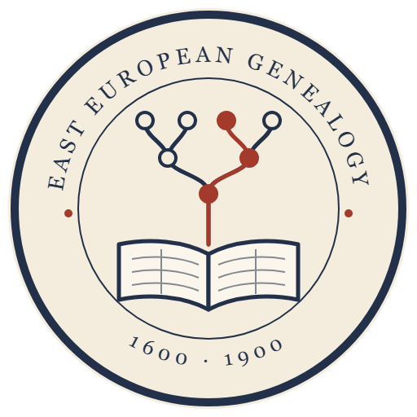

<p align="center">
  
</p>

<h1 align="center">Metryka</h1>

<p align="center"><em>Families before names, lists before metric books, every lead tracked.</em></p>

Metryka (`east-european-genealogy`) is an [Agent Skill](https://platform.claude.com/docs/en/agents-and-tools/agent-skills/overview)
for archival family-history research in the lands of the Russian Empire, Austrian Galicia
and the Polish-Lithuanian Commonwealth, 1600 to 1900: Ukraine, Russia, Belarus, Poland.

It holds the working rules of a family-history project that has worked daily with Claude
as its research assistant since August 2026: four family lines, about sixteen thousand
people, metric books, confession lists, revision tales and grod court books from archives
in Kyiv, Lviv, Odesa, Khmelnytskyi, Przemyśl and Warsaw. Each rule is there because
breaking it once cost a wrong ancestor, a lost lead or a wasted week, and each one carries
that reason next to it.

The name is the word for a parish register in Polish and Ukrainian, the book this research
keeps coming back to.

## What changes in practice

**People are identified by their family.** Two Ivans with the same patronymic in one village
a generation apart are the normal case. Claude matches a person only through the spouse,
parents, children, siblings, house and godparents, and checks the arithmetic of ages and
generations before accepting a match.

**The search starts from lists of families.** Confession lists, revision tales and tax
registers show whole households. Claude reads year-by-year metric books only around what a
list points to, instead of paging through them blind.

**A catalogue's silence is recorded as silence.** "Not in catalogue X" and "lost" are
different entries. A book is called lost only after three independent checks, written down
with the date.

**Doubtful letters are settled on the same sheet.** When Claude reads a scan looking for a
surname, it confirms each doubtful letter against a known word in the same hand. One early
session "found" the sought surname four times running; all four were other names.

**Every lead is tracked.** An unread case, a "not checked" mark or a side finding goes into
your tracker in the same step, labelled `[online]`, `[offline]` or `[not checked]` with the
evidence. Sessions stop re-checking the same catalogues.

**You pass the bot checks.** Claude never solves a CAPTCHA or enters a password. It opens the
page, tells you what to pass, and continues after you.

## What is inside

| File | Covers |
|---|---|
| `SKILL.md` | Ten hard rules, the research cycle from question to recorded result, working with the user (dictation, questions, scans) |
| `references/reading-manuscripts.md` | 18th and 19th century Cyrillic cursive (look-alike letter pairs and how to settle them), Church Slavonic numerals in dates, Galician Latin parish forms |
| `references/record-conventions.md` | Women's surnames, spelling variants and declension in search, patronymics, why stated ages lie, estate mobility, margin notes, godparents |
| `references/sources-ukraine.md` | TsDIAK, TsDIAL and regional archives, ARCHIUM catalogue API, the TsDIAK list of FamilySearch-digitized cases, uaroots, Odesa djvu paths, Wikisource and Commons |
| `references/sources-poland.md` | szukajwarchiwach, Geneteka, repcyfr (Przemyśl grod acts) with its OAI-PMH feed, AGAD, digital libraries, przydomki |
| `references/sources-russia.md` | Revision tales by year, service people before 1719, metric books and confession lists, lead sources |
| `references/familysearch-techniques.md` | Finding unindexed films by shelfmark keyword, mapping a film, JSON routes for DGS numbers and film parishes, mapping a reel of many cases by divider cards |
| `references/research-records.md` | Parish source tables, lead labels, the register of rejected versions, persons and places in a database |
| `references/agent-conduct.md` | Bot checks, background agents that save as they go, token economy, mixed-script typos, Windows shell traps with Cyrillic |

The routes and URLs were checked live on 25 October 2026. Archive sites change; when a route
fails, the skill tells Claude to say so and look for the current one.

## Installing

**Claude Code.** Clone the repository and link the skill into your skills directory:

```bash
git clone https://github.com/serge-it-max/east-european-genealogy.git ~/.claude/skills-src/east-european-genealogy
ln -s ~/.claude/skills-src/east-european-genealogy/skills/east-european-genealogy ~/.claude/skills/
```

Or copy `skills/east-european-genealogy` into `.claude/skills/` inside one project.

**Claude.ai.** Zip the `skills/east-european-genealogy` folder and upload it in Settings →
Capabilities → Skills.

## Adapting it to your project

The skill describes the method. Your project's own facts go in your `CLAUDE.md`, which takes
precedence wherever the two disagree:

- where your data lives (a database, a GEDCOM file, an online tree) and how to query it;
- your tracker for leads (GitHub Issues, a checklist file, a spreadsheet);
- the family lines and villages you are working on, with their source files;
- sources you do not use, and access you do not have;
- a pointer that makes Claude use the skill on every question in the project:

  ```markdown
  This folder holds my family-history research. Invoke the `east-european-genealogy` skill
  before answering any question about ancestors, records, archives or scans here, follow-up
  questions included.
  ```

The pointer matters. In our tests the skill fired by itself on an opening request ("how do
I find who his parents were?") but stayed unused on three follow-up questions about the same
family. With the pointer in `CLAUDE.md` it fired on all three, and the answers cited its
rules by number.

The skill works best with browser access (Claude in Chrome or a similar tool) in a browser
where you are signed in to FamilySearch and the archive portals you use.

## Scope

Not for living people, and not for 20th-century military, repression or deportation records.
It does not bypass access restrictions: restricted FamilySearch films and reading-room-only
units are labelled offline, and Claude looks for an openly published copy.

## License

MIT, see [LICENSE](LICENSE).

## Author

Built by [SergeIT](https://sergeit.it/) from a working genealogy project, and refined
against its real cases.

Issues and pull requests are welcome, particularly for archives and regions not covered here
(Lithuania, Belarus, Moldova, the Baltic provinces).
